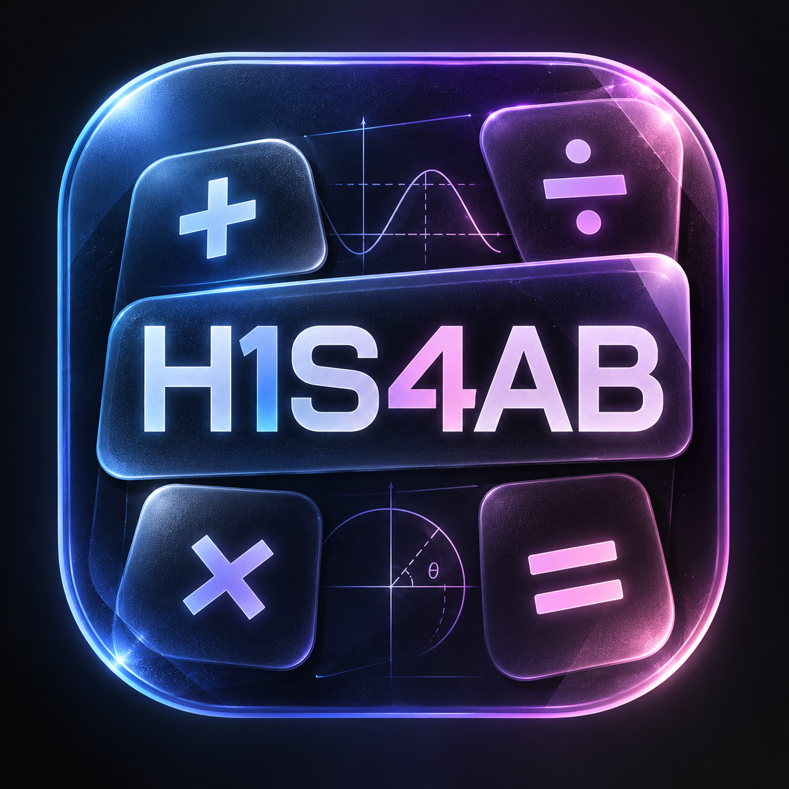

<!-- This section has been AI-generated by Gemini 3.8 Flash (High) on 24.10.2026 -->
# Hisaab (हिसाब)

<p align="center">
  
</p>

A powerful, memory-safe, hardware-accelerated **Spatial Calculator** with tactile frosted glass buttons, built in modern **C++20** and **Qt6 (Quick / QML)**, engineered for Wayland compositors (**Niri** and **Hyprland**), featuring 70ms hover zoom, and real-time color syncing with **Noctalia's dynamic templating engine**.

---

## 🌟 Key Features

### 1. Fixed KCalc Flaws
* **No More "Malformed Expression" Locks:**
  * **Intelligent Operator Replacement:** Typing consecutive binary operators (e.g., pressing `+` and then `*`) seamlessly replaces the previous operator (`5 * ` instead of KCalc's broken `5 + *`).
  * **Smart Unary Signs:** Allows unary minus directly following multiplication, division, or power (e.g., `5 * - 2 = -10`).
  * **Auto-Parentheses Closure:** Pressing `=` with unclosed parentheses automatically balances the expression (e.g., `sin(45 + 15` evaluates directly).
  * **Dangling Operator Trimming:** Pressing `=` on trailing operators (e.g., `12 + 4 +`) drops the dangling operator cleanly instead of throwing a syntax error.
  * **Live Result Preview:** Shows a real-time preview of the result as you type formula expressions.
  * **Clear Error Explanations:** Explains domain errors (e.g. `Division by zero`, `Square root of negative number`, `Domain error`) instead of cryptic codes.

### 2. High-Contrast Text Readability & Frosted Glass Styling
* **Frosted Glass Buttons:** Two-stop subtle gradient with top specular cut bevel highlight and bottom optical shelf shadow.
* **100% Solid Foregrounds:** Text and operator glyphs are rendered with zero alpha attenuation, preventing the washed-out "dirty window" look.
* **70ms Hover Zoom:** Clean, responsive 1.07x scale bounce with elevated z-index and 70ms debounce timer for frictionless mouse navigation.
* **Wayland Compositor Blur:** Submits a transparent Wayland surface buffer with window alpha, enabling native background blur under **Hyprland** and **Niri**.

### 3. Rich Mathematical Capabilities
* **Standard Mode:** Basic arithmetic, percentages, quick reciprocal (`1/x`), square root, sign toggling (`±`), and parentheses.
* **Scientific Mode:**
  * **Inverse Trig Toggle (`INV`):** Switch between direct (`sin`, `cos`, `tan`, `sec`, `csc`, `cot`) and inverse (`asin`, `acos`, `atan`, `asec`, `acsc`, `acot`) trigonometric functions.
  * **Reciprocal Trigs & Quick 1/x:** Full support for `sec`, `asec`, `cosec`, `acosec`, `cot`, `acot`.
  * **Angle Modes:** Fast toggle between **DEG** and **RAD**.
  * **Hyperbolic & Powers:** `sinh`, `cosh`, `tanh`, `xʸ`, `√x`, `x²`, `x!`, `nCr`, `nPr`.
  * **Constants:** `π`, `e`, `φ` (Golden ratio), `c` (Speed of light), `h` (Planck).
* **Programmer Mode (Numeral Systems):**
  * Radix: **HEX**, **DEC**, **OCT**, and **BIN** simultaneous live values.
  * Word Sizes: **64-bit (QWORD)**, **32-bit (DWORD)**, **16-bit (WORD)**, and **8-bit (BYTE)** with automated bit-masking.
  * Bitwise Operations: `AND`, `OR`, `XOR`, `NOT`, `<<` (LSH), `>>` (RSH), `ROL`, `ROR`.
  * **Interactive 64-Bit Matrix:** Click any individual bit in the visual bitset matrix to immediately flip it and recompute the active value.
* **Slide-out History Drawer & Mode Persistence:**
  * Remembers your last active mode across sessions via `QSettings`.
  * Smooth slide-in history drawer with copy and expression restore.
  * `ESC` hotkey dismisses history drawer if open, or quits the application.

---

## 🎨 Noctalia Dynamic Theming

The application connects directly to Noctalia in two complementary ways:
1. **GTK4 / Libadwaita Watcher:** Watches `~/.config/gtk-4.0/noctalia.css` in real-time. Whenever Noctalia regenerates system colors, `QFileSystemWatcher` triggers a hot-reload of the entire palette without restart.
2. **Optional JSON Template:** Can also consume `~/.config/noctalia/theme.json` via Noctalia template engine.

---

## 🚀 Installation & Build

### Requirements
* Arch Linux / Fedora / Ubuntu
* GCC 13+ or Clang 16+ supporting **C++20**
* Qt 6.5+ (Qt6Core, Qt6Gui, Qt6Quick, Qt6Qml)
* CMake 3.20+
* ImageMagick (optional, for icon generation)

### Build and Install
```bash
cmake -B build -S . -DCMAKE_BUILD_TYPE=Release
cmake --build build -j$(nproc)

# Install globally to user space
cp build/hisaab ~/.local/bin/hisaab
chmod +x ~/.local/bin/hisaab
cp hisaab.desktop ~/.local/share/applications/hisaab.desktop
update-desktop-database ~/.local/share/applications
```

---

## ⌨️ Compositor Keybinds & Rules

### Hyprland (`~/.config/hypr/hyprland.lua`)
```lua
-- Keybind:
hl.bind("XF86Calculator", hl.dsp.exec_cmd("uwsm app -- hisaab"))

-- Window Rule:
windowrulev2 = {
    match = { class = "hisaab" },
    float = true,
    size = { 460, 650 },
    center = true,
}
```

### Niri (`~/.config/niri/config.kdl`)
```kdl
// Keybind:
XF86Calculator { spawn "uwsm" "app" "--" "hisaab"; }

// Window Rule:
window-rule {
    match app-id="hisaab"
    open-floating true
    default-floating-size width=460 height=650
}
```
<!-- End of AI-generated section. -->
